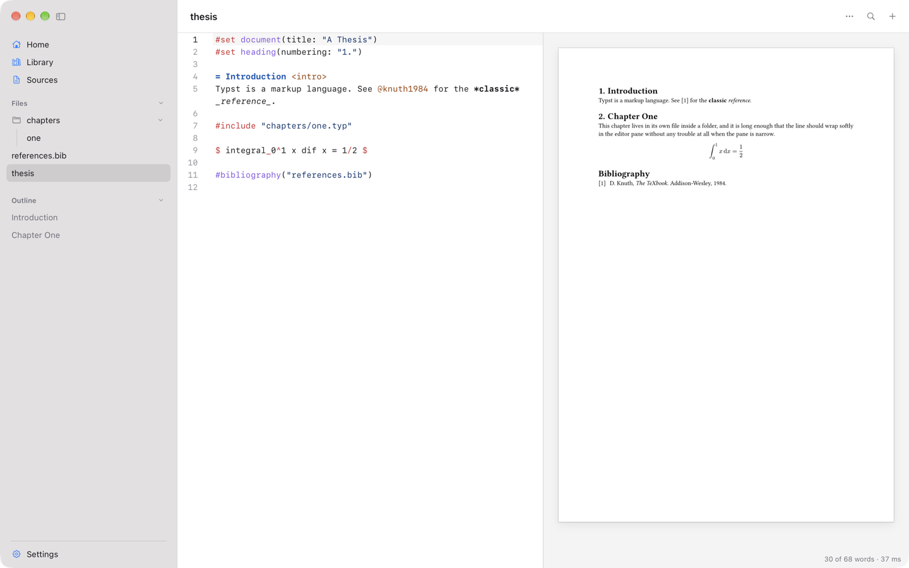

# Thesio

Obsidian for Typst. A folder of plain `.typ` files, a live preview compiled by [Typst](https://typst.app/), and one vault for notes, papers and citations.

[Build and release](docs/DEVELOPMENT.md) · [Architecture](docs/ARCHITECTURE.md) · [Product](PRODUCT.md) · MIT, see [LICENSE](LICENSE).
